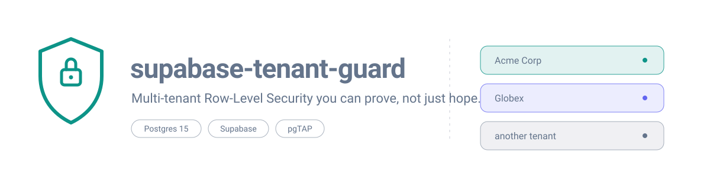
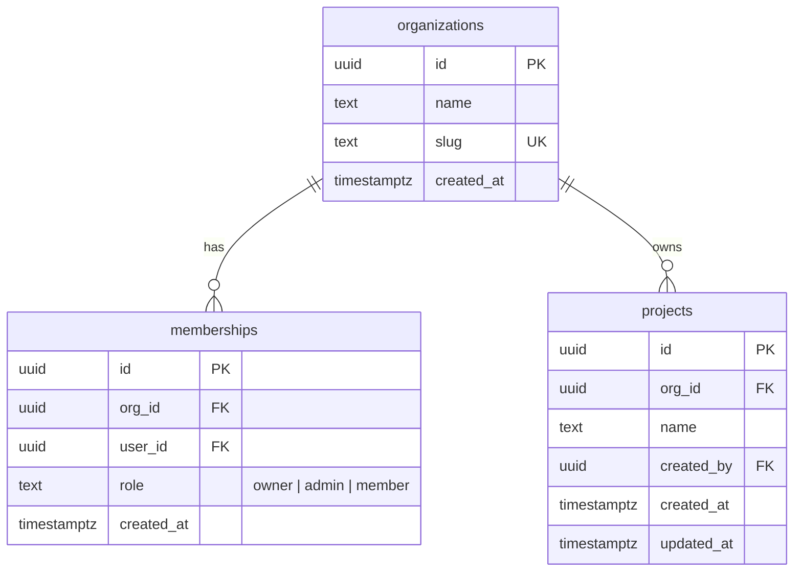

<p align="center">
  
</p>

# supabase-tenant-guard

**Multi-tenant Supabase with Row-Level Security you can prove, not just hope.**

Two companies can share one Supabase database without ever seeing each other's data, but only if every query, policy, and role is wired correctly. A single forgotten filter can show one customer's projects, invoices, or user list to another customer, and the request still returns a normal `200 OK`. That is the kind of mistake that ends trust in a B2B product.

This repository is a small, complete starting point for that problem. It gives you organizations, memberships, tenant-owned projects, and Row-Level Security policies written one operation at a time, so you can see exactly who is allowed to read, create, change, and delete each row.

It is for developers and small teams building a SaaS on Supabase who want tenant isolation now, not after a security review. You do not have to trust the prose in this README: the repository ships with a test suite that signs in as different users, switches to the same `authenticated` database role your API uses, and proves that one company cannot read or write another company's data.

## What you get

- Organizations, memberships with `owner` / `admin` / `member` roles, and an example `projects` table.
- Row-Level Security enabled on all three tables, with separate policies for `select`, `insert`, `update`, and `delete`.
- `WITH CHECK` on every write, immutable tenant keys, last-owner protection, and indexes for the columns the policies use.
- 71 pgTAP assertions covering two fictional companies, three users, cross-tenant reads and writes, role escalation, row moves, and anonymous access.
- A short `@supabase/supabase-js` example, a CI workflow, and a checklist of the [12 common RLS mistakes](docs/rls-pitfalls.md) this template avoids.

## Data model



`memberships.user_id` points at `auth.users`. Creating an organization automatically creates the first `owner` membership in the same transaction.

## Who can do what

| Action | owner | admin | member |
| --- | --- | --- | --- |
| View the organization and its members | yes | yes | yes |
| Update the organization | yes | yes | no |
| Delete the organization | yes | no | no |
| Add a member | yes | yes (not as owner) | no |
| Change a member's role | yes | yes (cannot grant or touch owners) | no |
| Remove a member | yes | yes (cannot remove owners) | self only |
| Leave the organization | yes, unless last owner | yes | yes |
| View projects | yes | yes | yes |
| Create and update projects | yes | yes | yes |
| Delete projects | yes | yes | no |
| Read or write another tenant | no | no | no |

Anonymous visitors have no table privileges at all. `service_role` bypasses RLS by design; use it only in trusted server-side jobs, never in a browser or in a normal request path.

## Quick start

Prerequisites: [Docker Desktop](https://www.docker.com/products/docker-desktop/) and the [Supabase CLI](https://supabase.com/docs/guides/cli). Node.js 20+ is only needed for the example client.

1. **Clone the repository**

   ```bash
   git clone https://github.com/crisnaveiro/supabase-tenant-guard.git
   cd supabase-tenant-guard
   ```

2. **Start the local stack**

   ```bash
   supabase start
   ```

3. **Apply migrations to a clean database**

   ```bash
   supabase db reset
   ```

4. **Run the RLS proof suite**

   ```bash
   supabase test db
   ```

5. **Connect your app** with the local API URL and anon key printed by `supabase start`, then call `listProjects(orgId)` from [`examples/client.ts`](examples/client.ts). Stop everything with `supabase stop` when you are done.

## Prove it

The proof lives in [`supabase/tests/001_tenant_isolation.test.sql`](supabase/tests/001_tenant_isolation.test.sql). It runs inside a transaction with pgTAP, fixes `request.jwt.claims` for each user, and switches to the `authenticated` role, which is the same role PostgREST uses for a signed-in request.

```bash
supabase test db
```

The suite proves, among other things:

- Acme Corp and Globex each see only their own organization, members, and projects.
- A member can create and update a project in their own organization but cannot insert, update, or delete one in another organization.
- Moving a project or a membership to another organization raises an error.
- A member cannot add members or promote themselves.
- An admin can manage members but cannot grant `owner`, demote an owner, or remove an owner.
- The last owner of an organization cannot leave or demote themselves.
- A former member cannot add themselves back.
- An anonymous visitor cannot read or write any tenant table.

If you add a table, add a test that proves the negative case too. A policy that merely "looks right" is not evidence.

## Files

```text
supabase/
  config.toml
  migrations/20260101000000_tenant_guard.sql   schema, functions, policies, indexes
  tests/001_tenant_isolation.test.sql          pgTAP proof suite
examples/
  client.ts                                    list projects for the active org
docs/
  banner.svg
  rls-pitfalls.md                              12 mistakes and how this avoids them
.github/workflows/tests.yml                    CI: start Supabase and run the suite
```

## Adding your own tenant tables

Follow the same shape as `projects`:

1. Add a `org_id uuid not null references public.organizations (id) on delete cascade`.
2. Index `org_id` (and any other column a policy filters on).
3. Enable RLS.
4. Write four policies. Use `public.is_member(org_id)` for reads, `public.has_role(org_id, array['owner', 'admin'])` for privileged writes, and always add `WITH CHECK`.
5. Make `org_id` immutable with a trigger, because a policy cannot read the old row.
6. Add positive and negative pgTAP tests.

The helper functions are deliberately small. Keep authorization in `memberships`; do not put roles in `user_metadata`.

## FAQ

**Is this production-ready?**
It is a reviewed starting point, not a drop-in security guarantee. Read the migration, run the tests, and have someone review your own tables and policies before you handle real customer data.

**Does it work with hosted Supabase?**
Yes. Push the migration with `supabase db push` (or apply it through your normal migration pipeline) and run the test suite locally. The policies do not depend on anything that is only available in the local stack.

**Why not one schema or one database per tenant?**
That is a valid design with different operational costs. This template uses a shared schema plus RLS because it matches how most Supabase SaaS apps start. If you outgrow it, the membership model still maps cleanly to schema-per-tenant.

**Why is the anon key in a browser?**
The anon key identifies the project, not the user; it is public by design. RLS decides what the signed-in user can read. The `service_role` key bypasses RLS and must never reach a client.

**Can I use Drizzle, Prisma, or raw SQL?**
Yes. Keep the policies and triggers in migrations, apply them to the database, and make sure application queries run as an authenticated user rather than as the database owner.

**What happens when an owner deletes their account?**
The last-owner trigger blocks an end user from removing or demoting the final owner. Trusted administrative contexts with no end-user identity can still perform cleanup, so plan an explicit ownership transfer before deleting an owner account.

**Does the test suite need Docker?**
Yes. `supabase test db` needs the local Supabase stack running (`supabase start`), which runs in Docker.

## Roadmap

- Invitations with expiring tokens and an acceptance flow.
- An append-only audit log for membership and role changes.
- Custom roles and per-resource permissions beyond the three built-in roles.
- Storage bucket policies that follow the same tenant model.
- A small org switcher example for React.
- A test matrix across supported Postgres versions.

Contributions are welcome; see [CONTRIBUTING.md](CONTRIBUTING.md).

## License

MIT. See [LICENSE](LICENSE).

---

Built by Cristóbal Naveiro · [crisnaveiro.com](https://crisnaveiro.com)
